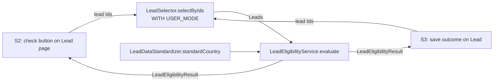

# Architecture: BR014-S1 Consistent eligibility decision

**Status:** Approved
**Architect:** Asad Kayani — **Decision date:** 2026-10-16

> Brief written 2026-10-16. It reuses the design approved on 2026-10-11 (commit `dd9602e`): SCRUM-5 to SCRUM-8 haven't changed since, and `playbook-dev` still matches the base in `develop`.

## 1. Context

- **Epic and sibling stories considered:** BR-014 Quick Eligibility Check (SCRUM-5). BR014-S1 (SCRUM-6), BR014-S2 Eligibility on demand (SCRUM-7), BR014-S3 Recorded eligibility outcome (SCRUM-8). All three ship together in release/2026.10.
- **What this story must deliver:** one place that judges a lead against rules R1–R5 and returns the same answer, with reasons, for every rep. S1 is the decision engine only. It has no UI and saves nothing.
- **How the siblings use it:**
  - S2 runs the check from the Lead record page with one click (AC 1), shows the result and every reason in plain words (AC 2, 3), must match S1 (AC 4), uses the latest saved values (AC 5), answers within 2 seconds (AC 6) and shows a clear message when a field can't be read (AC 7).
  - S3 saves the result, reasons, who checked and when (AC 1). The saved outcome changes **only** when someone runs a check, not when lead details change (AC 6).
- **What this means for S1:** the decision must run **on demand**, from a caller, not on every save. Its result must carry everything S2 shows and S3 saves.

**Rules (from SCRUM-6):** R1 based in the US, Canada or UK · R2 50 or more employees · R3 annual revenue of 1M or more · R4 not Government or Education · R5 has an email address.

## 2. Current state and impact

| Component                        | Exists today | Impact                                                                                                            |
| -------------------------------- | ------------ | ----------------------------------------------------------------------------------------------------------------- |
| LeadTrigger / LeadTriggerHandler | Yes          | **None.** The check runs on demand, not on save (S3 AC 6)                                                         |
| LeadDataStandardizer             | Yes          | **Reused, not changed.** `standardCountry()` maps "USA", "US", "U.K." etc. to one name for R1 (AC 6)              |
| LeadSelector                     | Yes          | **Reused, not changed.** `selectByIds()` already returns all six rule fields, `WITH USER_MODE`                    |
| Lead_Default_Rating flow         | Yes          | **None.** Before-save flow on LeadSource → Rating. No overlap with the rule fields                                |
| Lead_Record_Page                 | Yes          | **None in S1.** S2 adds the check component                                                                       |
| Sales_Rep_Base                   | Yes          | **None in S1.** Already grants read on NumberOfEmployees, AnnualRevenue, Industry and Email. S2 adds class access |
| TestDataFactory                  | Yes          | **Reused.** `buildLead()` returns a lead that passes all five rules                                               |

Org facts re-checked in `playbook-dev` on 2026-10-16 (metadata retrieved to a scratch folder, not `force-app`). `LeadTrigger`, `LeadTriggerHandler`, `TriggerHandler`, `LeadSelector`, `LeadDataStandardizer` and `TestDataFactory` match `develop`. There are no eligibility classes yet. The Industry value set includes `Government` and `Education`. The project has no OmniStudio components, and the only Lead flow is `Lead_Default_Rating` (before-save, LeadSource → Rating). Facts carried over from 2026-10-11: Country is free text (no State and Country picklists). Industry is the standard picklist and includes `Government` and `Education`. The org is single-currency. No Lead custom fields. 12 sample leads cover every rule and edge case.

**Dependencies on sibling stories:** none for S1. S2 and S3 both depend on S1's interface (section 6), so S1 merges first.

## 3. Options

|                       | Option A: Apex service, on demand                                                                                                                                                    | Option B: Record-triggered flow                                                                                                                                                                                                                                              | Option C: Apex service, rules in Custom Metadata                                                                                          |
| --------------------- | ------------------------------------------------------------------------------------------------------------------------------------------------------------------------------------ | ---------------------------------------------------------------------------------------------------------------------------------------------------------------------------------------------------------------------------------------------------------------------------- | ----------------------------------------------------------------------------------------------------------------------------------------- |
| Summary               | A stateless Apex class takes Leads and returns one result per lead. Callers (S2, S3) load the leads and call it.                                                                     | A before-save flow works out eligibility on every insert and update and writes it to fields on the Lead.                                                                                                                                                                     | Same as A, but thresholds, countries and excluded industries live in a Custom Metadata type the admin can edit.                           |
| Pros                  | One engine for S2 and S3, so answers always match (S2 AC 4). Lists every failed rule easily (AC 3). Pure function: fast, bulk-safe, easy to test. Reuses `standardCountry()` (AC 6). | Clicks, not code. Always up to date on the record.                                                                                                                                                                                                                           | Admins change thresholds without a deploy.                                                                                                |
| Cons                  | Rule changes need a deploy.                                                                                                                                                          | Runs on every save, which breaks S3 AC 6 ("doesn't change until someone runs a check"). Needs S3's fields to exist first. Listing **every** failed rule and missing detail as plain text is awkward in a flow. Can't reuse `standardCountry()` without an invocable wrapper. | More parts (CMDT type, records, loader, tests) for a need nobody has asked for. Thresholds could drift from what the business signed off. |
| Fits sibling stories? | **Yes.** S2 calls it on click, S3 calls it and saves the result.                                                                                                                     | **No.** Conflicts with S3 AC 6 and S2's "check on demand".                                                                                                                                                                                                                   | Yes, but adds work to S1 with no story asking for it.                                                                                     |

## 4. Security and NFRs

- [x] **Sharing model and class sharing keywords:** both new classes are `with sharing`. The service reads no records itself, so sharing is enforced where leads are loaded (`LeadSelector`, `inherited sharing`, called from `with sharing` code).
- [x] **CRUD/FLS:** the service runs no SOQL and no DML. Callers must load leads through `LeadSelector.selectByIds()` (`WITH USER_MODE`). A rep who can't read a rule field then gets a clear error, not a silent "missing" answer. This protects AC 7 (same answer for every rep). Callers must **not** use `Security.stripInaccessible` on these fields, because a stripped field would read as blank and change the answer. S1 adds no fields, so no field permissions are needed for `Sales_Rep_Base` or the Admin profile. S3 handles that for its fields.
- [x] **Bulk:** one loop over the input, constant work per lead, no SOQL or DML. Test with 200 leads (team rule, AC 8).
- [x] **Governor limits:** no queries, no DML, no callouts. CPU is a few comparisons per lead. Well inside S2's 2-second target.
- [x] **Data classification:** demo data only. No `System.debug` of lead data in the service, the tests or the try-it script.
- [x] **Input guard:** a `null` lead or `null` list throws `IllegalArgumentException` with a clear message, not a NullPointerException.

## 5. Recommendation

**Option A: Apex service, run on demand.**

It is the only option that fits all three stories. S2 and S3 both need the outcome to come from a deliberate check, not from a save, and a single engine keeps the answer identical wherever it is shown or stored. It lists every failed rule and missing detail, reuses the existing country standardizer, and is easy to test in bulk.

Trade-offs accepted:

- A threshold change needs a code deploy. The rules are signed off by the business and change rarely. Option C can be added later without changing the interface.
- The service trusts its caller to load the fields. The `REQUIRED_FIELDS` list and the rule "load through `LeadSelector`" make that contract explicit for S2 and S3.

## 6. Design and build plan

| #   | Component                           | Type            | New/Changed | Test                   |
| --- | ----------------------------------- | --------------- | ----------- | ---------------------- |
| 1   | `LeadEligibilityResult`             | Apex class      | New         | Covered by #3          |
| 2   | `LeadEligibilityService`            | Apex class      | New         | Covered by #3          |
| 3   | `LeadEligibilityServiceTest`        | Apex test class | New         | —                      |
| 4   | `scripts/apex/br014-s1-try-it.apex` | Anonymous Apex  | New         | Demo aid, not deployed |

**`LeadEligibilityResult`** (`@AuraEnabled` properties, so S2 can return it straight to an LWC):

- `Id leadId`
- `Boolean isEligible`
- `String outcome`: `Eligible` or `Not eligible` (constants `ELIGIBLE`, `NOT_ELIGIBLE`)
- `List<String> failedRules`: rule codes, for example `R2`, `R4`. Only R1–R4 can appear: a missing email is a missing detail (AC 4), so R5 never shows up here. S3 reports must not expect an `R5` value.
- `List<String> missingDetails`: for example `Email`, `Number of employees`
- `List<String> reasons`: one plain-word line per failed rule or missing detail, for S2 and S3

**`LeadEligibilityService`:**

- `public static List<LeadEligibilityResult> evaluate(List<Lead> leads)`: one result per lead, same order as the input.
- `public static LeadEligibilityResult evaluate(Lead lead)`: convenience for a single lead (S2's one click).
- `public static final List<SObjectField> REQUIRED_FIELDS`: Country, NumberOfEmployees, AnnualRevenue, Industry, Email. S2 and S3 use it to check their query covers every rule field.
- Rule constants: `MIN_EMPLOYEES = 50`, `MIN_ANNUAL_REVENUE = 1000000`, `ELIGIBLE_COUNTRIES` (from the `LeadDataStandardizer` constants), `EXCLUDED_INDUSTRIES = {'government', 'education'}`, compared case-insensitively after trimming.
- Each rule is checked separately and every outcome is collected. It never stops at the first failure (AC 3).
- A blank value adds a missing detail, not a failed rule (AC 4). The lead is then Not eligible.
- R1 runs the country through `LeadDataStandardizer.standardCountry()` before comparing (AC 6).
- Reason text is built from the constants (for example "Fewer than 50 employees"), so a threshold change can't leave stale text.
- `null` input throws `IllegalArgumentException`.

**Tests (`LeadEligibilityServiceTest`):**

| Test                                                                                                                 | Covers          |
| -------------------------------------------------------------------------------------------------------------------- | --------------- |
| Lead passing all five rules is Eligible, with no reasons                                                             | AC 1            |
| One lead per failed rule (R1, R2, R3, R4 Government, R4 Education), each Not eligible with only that rule and reason | AC 2            |
| Lead failing R1, R2 and R4 lists all three, in rule order                                                            | AC 3            |
| One lead per blank field (Country, employees, revenue, industry, email), each Not eligible with only that detail     | AC 4            |
| Fails a rule and missing a value (Pine County case) lists both                                                       | AC 3, 4         |
| 50 employees and 1,000,000 revenue pass; 49 and 999,999 fail                                                         | AC 5            |
| "USA", "US", "us", " United States ", "Canada", "U.K.", "United Kingdom" pass R1; "Germany" fails                    | AC 6            |
| Same lead evaluated as an admin and as a rep (`System.runAs`) gives the same result                                  | AC 7            |
| Insert 200 mixed leads, load them through `LeadSelector`, evaluate: each gets the expected result, in input order    | AC 8            |
| `null` lead and `null` list throw `IllegalArgumentException`                                                         | Input guard     |
| `REQUIRED_FIELDS` holds exactly the five rule fields                                                                 | Caller contract |

Uses `TestDataFactory` and the `Assert` class. Target 90% or more coverage on both new classes.

**Try-it script (#4):** builds sample leads in memory and prints each outcome and its reasons. It does not query or print real org leads.

**Deploy order:** `LeadEligibilityResult` → `LeadEligibilityService` → `LeadEligibilityServiceTest`. No metadata, layout, flow or permission set changes in S1.

**Tests:** Apex: `LeadEligibilityServiceTest` (step 16). Jest: none in S1 (S2 owns the LWC tests). Playwright: none in S1. S1 has no UI, so it skips the step 17 story UI test; S2 owns it.

## 7. Open questions for the business

1. **Missing data versus a failed rule** (the open decision in the README; sample lead `Pine County Services`). This design follows SCRUM-6 AC 4: missing data gives **Not eligible**, with the missing details listed. A lead that fails a rule _and_ is missing data lists both. Please confirm.
   - **Recommended:** confirm as written.
   - **Answer:** Confirmed as written. Missing data gives Not eligible with the missing details listed; a lead that fails a rule and is missing data lists both.
2. **Data loads.** AC 8 is read as "the rules give correct answers in bulk", not "every data load runs a check". Running a check on load would save outcomes without a rep asking, which S3 AC 6 rules out. Please confirm.
   - **Recommended:** confirm. A data load does not run a check.
   - **Answer:** Confirmed. AC 8 means correct answers in bulk; a data load does not run a check.
3. **Currency.** The org is single-currency. R3 compares AnnualRevenue in the org currency against 1,000,000. Please confirm the 1M threshold is in that currency.
   - **Recommended:** confirm.
   - **Answer:** Confirmed. The 1,000,000 threshold is in the org currency.
4. **Fixed rules.** Thresholds, countries and excluded industries are fixed in code (Option A). A change needs a release. Is that acceptable, or does the business need to change them without a release (Option C)?
   - **Recommended:** fixed in code. A rule change goes through a release.
   - **Answer:** Fixed in code. A rule change goes through a release.
5. **Build order.** S2 and S3 call S1's interface (section 6). Should S1 merge into `develop` before S2 and S3 branch, or should S2 and S3 build in parallel against the agreed interface?
   - **Recommended:** S1 merges first, then S2 and S3 branch from `develop`. This is the order used in the 2026-10-15 rehearsal.
   - **Answer:** S1 merges into `develop` first, then S2 and S3 branch from `develop`.

## 8. Approval

- **Decision:** Approved: Option A (Apex service, run on demand)
- **Architect:** Asad Kayani, 2026-10-16
- **Open questions:** all answered in section 7
- **Plan changes:** none
- **Conditions:** none
- **Blockers before build:** none (S1 has no dependencies on sibling stories)
