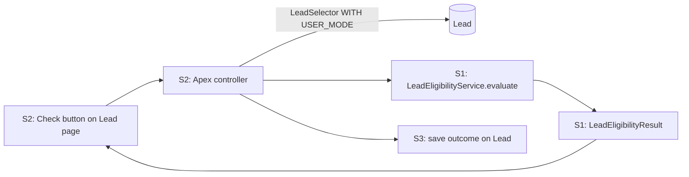

# Architecture: BR014-S1 Consistent eligibility decision

**Status:** Approved, Option A: Apex service, run on demand
**Architect:** Asad Kayani — **Decision date:** 2026-10-10

## 1. Context

- **Epic and sibling stories considered:** BR-014 Quick Eligibility Check (SCRUM-5). BR014-S1 (SCRUM-6), BR014-S2 Eligibility on demand (SCRUM-7), BR014-S3 Recorded eligibility outcome (SCRUM-8). All three ship together in `release/2026.10`.
- **What this story must deliver:** one place that judges a lead against rules R1–R5 and returns the same answer, with reasons, for every rep. S1 is the decision only. S2 adds the button on the lead page. S3 saves the outcome on the lead.

**Rules (from SCRUM-6):**

| Rule | Passes when                                  | Missing when          |
| ---- | -------------------------------------------- | --------------------- |
| R1   | Country is United States, Canada or United Kingdom | Country blank         |
| R2   | NumberOfEmployees >= 50                      | NumberOfEmployees null |
| R3   | AnnualRevenue >= 1,000,000                   | AnnualRevenue null    |
| R4   | Industry is not Government or Education      | Industry blank        |
| R5   | Email is present                             | Email blank           |

**Decision:** all five pass → **Eligible**. Any rule failed or any value missing → **Not eligible**. The result lists every failed rule and every missing detail (AC 3 and 4). A lead that fails a rule and is missing data is Not eligible and shows both. This settles the "Pine County Services" case the README left open.

## 2. Current state and impact

Checked against the code in this worktree and the `playbook-dev` org (Active, expires 2026-11-02). The org has no custom Lead fields, 12 sample leads, and the base classes only.

| Component                        | Exists today | Impact |
| -------------------------------- | ------------ | ------ |
| LeadTrigger / LeadTriggerHandler | Yes          | **None.** S1 does not run on save (see section 3). |
| LeadDataStandardizer             | Yes          | **Reused, not changed.** R1 calls `standardCountry()` so "USA", "US" and "United States" match (AC 6). |
| LeadSelector                     | Yes          | **None in S1.** `selectByIds` already returns all five rule fields. S2 uses it. |
| TestDataFactory                  | Yes          | **None.** `buildLead()` already returns an eligible lead; tests override one field at a time. |
| Lead_Default_Rating flow         | Yes          | **None.** Before-save flow on LeadSource/Rating. No overlap. |
| Lead_Record_Page                 | Yes          | **None in S1.** S2 adds the check component. |
| Sales_Rep_Base permission set    | Yes          | **None in S1.** S2 adds Apex class access. |

**Dependencies on sibling stories:**

- **S2 calls S1.** S2's Apex controller loads the lead with `LeadSelector.selectByIds` (`WITH USER_MODE`) and passes it to `LeadEligibilityService.evaluate`. S2 AC 4 ("matches the S1 decision") holds because there is only one rule engine.
- **S3 saves S1's result.** S3 stores `LeadEligibilityResult` (result, reasons, checked by, checked on). S3 AC 6 says the saved outcome must not change when lead details change, only when someone runs a check. **This rules out computing eligibility on save.**
- **Build order:** S1 must exist before S2 and S3 can compile. See open question 3.

## 3. Options

|                       | Option A: Apex service, run on demand | Option B: Record-triggered Flow |
| --------------------- | ------------------------------------- | ------------------------------- |
| Summary               | A stateless Apex class takes a list of Leads and returns one result per lead. No queries, no DML. Callers decide when to run it. | A before-save flow on Lead works out the result on every create and update, with decision elements per rule. |
| Pros                  | One rule engine for S1, S2 and S3. Lists every failed rule and missing detail easily. Reuses `LeadDataStandardizer`. Fast, full unit tests with exact boundary cases. Bulk-safe by design. | Admins can read and change it without code. No Apex to maintain. |
| Cons                  | Rule changes need a developer and a deploy. | Runs on every save, so the outcome changes when lead details change. That breaks **S3 AC 6**. Hard to collect *every* failed rule into one reason list. Would copy the country alias list instead of reusing it. Harder to test boundaries. |
| Fits sibling stories? | **Yes.** S2 calls it on click; S3 saves what it returns. | **No.** Conflicts with S3 AC 6, and S2 would need a second, on-demand path anyway. |

Formula fields were also considered and rejected for the same reason as Option B: they recalculate live, and they cannot list every reason in plain words.

## 4. Security and NFRs

- [x] **Sharing model and class sharing keywords:** `LeadEligibilityService` is `with sharing`. `LeadEligibilityResult` is a plain data class. Neither queries or saves records.
- [x] **CRUD/FLS:** S1 has no SOQL or DML, so it adds no Code Analyzer findings. Field access is enforced where data is read: S2 loads leads with `LeadSelector` (`WITH USER_MODE`). **Note for S2:** if a rep cannot read one of the five fields, `WITH USER_MODE` fails the query. S2 must show a clear message (S2 AC 7). It must never evaluate a lead with hidden fields, because that would give different answers for different reps and break S1 AC 7.
- [x] **Bulk:** one pass over the list, no SOQL or DML in loops. Test with 200 mixed leads (AC 8).
- [x] **Governor limits:** CPU only, about 5 comparisons per lead. 200 leads is well inside limits.
- [x] **Data classification:** demo data only. Results hold rule codes and field names, never email addresses or other lead values. No `System.debug` of lead data.
- [x] **Same answer for every rep (AC 7):** the result depends only on the lead's field values. No user, profile, time or org data is used.

## 5. Recommendation

**Option A: Apex service, run on demand.**

It is the only option that fits all three stories. S2 and S3 both depend on the outcome being produced by a deliberate check, not on save. A single Apex engine keeps the answer identical wherever it is shown or stored. The trade-off is that rule changes need a deploy. That is fine for five agreed rules that change rarely. If the business later wants to change thresholds without a release, the constants can move to Custom Metadata without changing callers.

## 6. Design and build plan

| #   | Component | Type | New/Changed | Test |
| --- | --------- | ---- | ----------- | ---- |
| 1   | `LeadEligibilityResult` | Apex class | New | Covered by #3 |
| 2   | `LeadEligibilityService` | Apex class | New | Covered by #3 |
| 3   | `LeadEligibilityServiceTest` | Apex test class | New | — |

**`LeadEligibilityResult`** (`@AuraEnabled` properties, so S2 can return it directly):

- `Id leadId`
- `Boolean isEligible`
- `String outcome`: `Eligible` or `Not eligible`
- `List<String> failedRules`: for example `R2`, `R4`
- `List<String> missingDetails`: for example `Email`, `Number of employees`
- `List<String> reasons`: plain-word lines for S2 and S3, for example "Fewer than 50 employees", "Email is missing"

**`LeadEligibilityService`:**

- `public static List<LeadEligibilityResult> evaluate(List<Lead> leads)`: one result per lead, same order as the input.
- `public static LeadEligibilityResult evaluate(Lead lead)`: convenience for a single lead.
- Constants for the rules: `MIN_EMPLOYEES = 50`, `MIN_ANNUAL_REVENUE = 1000000`, `ELIGIBLE_COUNTRIES` (from `LeadDataStandardizer` constants), `EXCLUDED_INDUSTRIES = {'Government', 'Education'}`.
- Each rule is checked separately and every outcome is collected. It never stops at the first failure (AC 3).
- A blank value adds a missing detail, not a failed rule (AC 4). Missing email is reported as "Email is missing".
- R1 runs the country through `LeadDataStandardizer.standardCountry()` before comparing (AC 6).

**Tests (`LeadEligibilityServiceTest`):**

| Test | Covers |
| ---- | ------ |
| Lead passing all five rules is Eligible | AC 1 |
| One test per rule failing, each Not eligible with that rule listed | AC 2 |
| Lead failing R1, R2 and R4 lists all three | AC 3 |
| One test per blank field, each Not eligible with that detail listed | AC 4 |
| Fails a rule and missing a value (Pine County case) lists both | AC 3, 4 |
| 50 employees and 1,000,000 revenue pass; 49 and 999,999 fail | AC 5 |
| "USA", "US", "us", " United States " and "U.K." pass R1; "Germany" fails | AC 6 |
| Same lead evaluated as two different users gives the same result | AC 7 |
| Insert 200 mixed leads (team rule), then evaluate: each gets the expected result, in input order | AC 8 |

Uses `TestDataFactory.buildLead()` and the `Assert` class. Target 90% or more coverage on both new classes.

**Deploy order:** `LeadEligibilityResult` → `LeadEligibilityService` → `LeadEligibilityServiceTest`. No metadata, layout or permission changes in S1.

**Tests:** Apex: `LeadEligibilityServiceTest` (step 16). Jest: none in S1 (S2 owns the LWC tests). Playwright: none in S1. S1 has no UI, so it skips the step 17 story UI test. S2 owns that test.

## 7. Open questions for the business

1. **Missing data versus a failed rule.** This design follows SCRUM-6 AC 4: missing data gives **Not eligible**, with the missing details listed. Please confirm AC 4.
   - **Answer (2026-10-10):** Confirmed. Missing data gives Not eligible.
2. **Data loads.** AC 8 is read as "the rules give correct answers in bulk", not "every data load runs a check". Running a check on load would save outcomes without a rep asking, which S3 AC 6 seems to rule out. Please confirm.
   - **Answer (2026-10-10):** Confirmed. Bulk means correct answers for many leads at once. A data load does not run a check.
3. **Build order for the demo.** S2 and S3 both call S1. They cannot be built and merged before the session unless S1 exists first. Options: build S1 for real before the session and replay it live from the `demo/stage-*` tags, or build S2 and S3 against this agreed interface and merge S1 first on the day.
   - **Answer (2026-10-10):** Option A. Build S1 now with checkpoint tags, then rebuild it live in the session and jump to a checkpoint if a step fails.
4. **Currency.** R3 assumes a single-currency org, with AnnualRevenue in the org currency. Confirm the 1M threshold is in that currency.
   - **Answer (2026-10-10):** Confirmed. Single-currency org; 1M is in the org currency.
