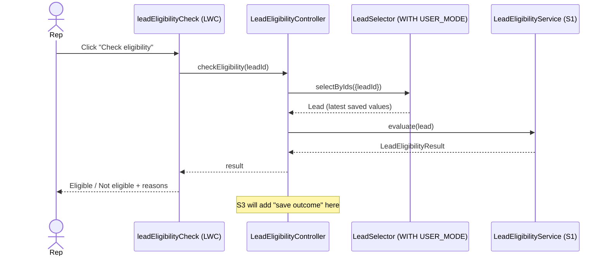

# Architecture: BR014-S2 Eligibility on demand

**Status:** Approved
**Architect:** Asad Kayani — **Decision date:** 2026-10-15

## 1. Context

- **Epic and sibling stories considered:** BR-014 Quick Eligibility Check (SCRUM-5). BR014-S1 Consistent eligibility decision (SCRUM-6, in `develop` at `b3951d6`, Ready for Release). BR014-S2 (SCRUM-7). BR014-S3 Recorded eligibility outcome (SCRUM-8, To Do). All three ship together in release/2026.10.
- **What this story must deliver:** a one-click check on the Lead record page that shows **Eligible** or **Not eligible** and, when not eligible, every failed rule and missing detail in plain words. It must match S1 exactly, use the latest saved values, answer within 2 seconds, show a clear message when it can't run, and work for reps with `Sales_Rep_Base`.
- **How it fits the siblings:**
  - S1 owns the decision (`LeadEligibilityService.evaluate`). S2 only loads the lead, calls S1 and shows the result. No rule logic in S2 (AC 4).
  - S3 saves each check's result, reasons, who and when on the lead (S3 AC 1) and changes it only when someone runs a check (S3 AC 6). S2's check **is** that action, so S3 will add its save step to S2's controller. S2 itself saves nothing.

## 2. Current state and impact

| Component                            | Exists today      | Impact                                                                                      |
| ------------------------------------ | ----------------- | ------------------------------------------------------------------------------------------- |
| LeadTrigger / LeadTriggerHandler     | Yes               | **None.** The check runs on click, not on save                                              |
| LeadDataStandardizer                 | Yes               | **None directly.** S1 uses it for R1                                                        |
| LeadSelector                         | Yes               | **Reused, not changed.** `selectByIds()` returns all five rule fields, `WITH USER_MODE`     |
| LeadEligibilityService / Result (S1) | Yes, in `develop` | **Called, not changed**                                                                     |
| Lead_Default_Rating flow             | Yes               | **None**                                                                                    |
| Lead_Record_Page                     | Yes               | **Changed.** Add the new check component to the sidebar, under `leadProfileCard`            |
| Sales_Rep_Base                       | Yes               | **Changed.** Add class access to the new controller. Add read on `Lead.Address` (see below) |
| leadProfileCard (LWC)                | Yes               | **Pattern only.** The new component follows its structure and Jest style                    |
| tests/ui/story                       | Empty             | **New Playwright story test** (step 17)                                                     |

Org facts checked in `playbook-dev` (2026-10-15):

- `Sales_Rep_Base` matches git. It grants read on NumberOfEmployees, AnnualRevenue, Industry and Email, but **not Country**, and no Apex class access. Reps read Country today only because the **Standard User profile** grants read on the compound `Lead.Address` field. A rep on a narrower profile would hit AC 7's error even with `Sales_Rep_Base`, which breaks AC 8.
- `Sales_Rep_Base` has 1 assignment (a System Administrator).
- `Lead_Record_Page` in the org matches git: highlights panel, detail panel and `leadProfileCard` in the sidebar.
- S1's `LeadEligibilityResult`, `LeadEligibilityService` and `LeadEligibilityServiceTest` are deployed. No `LeadEligibilityController` and no `leadEligibilityCheck` yet; `leadProfileCard` is the only LWC.
- Sample leads for the UI test are in place: Acme Robotics (passes all rules) and Pine County Services (Government, no email).

**Dependencies on sibling stories:** S2 needs S1's `LeadEligibilityService` and `LeadEligibilityResult`. Both are in `develop` (`b3951d6`), so S2 is not blocked. S3 depends on S2's controller.

## 3. Options

|                       | Option A: LWC + Apex controller                                                                                                                                                                                                                                          | Option B: Screen flow from a quick action                                                                                                                                                                                                       | Option C: LWC with the rules in JavaScript                                                                                                                    |
| --------------------- | ------------------------------------------------------------------------------------------------------------------------------------------------------------------------------------------------------------------------------------------------------------------------ | ----------------------------------------------------------------------------------------------------------------------------------------------------------------------------------------------------------------------------------------------- | ------------------------------------------------------------------------------------------------------------------------------------------------------------- |
| Summary               | A small LWC card with a "Check eligibility" button calls an `@AuraEnabled` Apex method. The method loads the lead through `LeadSelector` and calls S1's service.                                                                                                         | A "Check eligibility" quick action opens a screen flow. An invocable Apex action wraps S1's service, and a screen shows the result.                                                                                                             | The LWC reads the lead with `getRecord` and works out R1–R5 in the browser.                                                                                   |
| Pros                  | Uses S1 as is, so answers match (AC 4). One call, no cache, so it uses the latest saved values (AC 5). Fast (AC 6). Clear error handling in Apex and the UI (AC 7). Follows the existing `leadProfileCard` pattern and its Jest tests. One place for S3 to add its save. | Clicks for the screen. A quick action is a familiar pattern.                                                                                                                                                                                    | No Apex.                                                                                                                                                      |
| Cons                  | Code, not clicks.                                                                                                                                                                                                                                                        | More parts: quick action, flow, invocable wrapper, page change. Listing every reason needs a loop or a text collection in the flow. A modal is an extra step for the rep. Flow error screens are harder to make clear (AC 7). No Jest coverage. | Duplicates S1's rules in JavaScript, so the two can drift (breaks AC 4). Can't reuse `LeadDataStandardizer` (S1 AC 6). S3 can't reuse it to save the outcome. |
| Fits sibling stories? | **Yes.** S1 as is; S3 adds a save step in the same controller method.                                                                                                                                                                                                    | Partly. S3 would add its save to the flow.                                                                                                                                                                                                      | **No.** Breaks the single engine.                                                                                                                             |

## 4. Security and NFRs

- [x] **Sharing model and class sharing keywords:** `LeadEligibilityController` is `with sharing`. A rep can only check leads they can see.
- [x] **CRUD/FLS:** the lead is loaded with `LeadSelector.selectByIds()` (`WITH USER_MODE`). If the rep can't read the lead or a rule field, the query throws instead of returning blanks, so the rep never gets a wrong "missing" answer (S1 section 4). The controller turns that into a clear `AuraHandledException` message (AC 7). Fields are not stripped with `Security.stripInaccessible`.
- [x] **Permissions:** `Sales_Rep_Base` gets class access to `LeadEligibilityController` (AC 8) and read on `Lead.Address`, which carries Country for R1 (read only, not edit). The S1 classes need no class access; only the `@AuraEnabled` entry point does. No new fields, so no Admin profile or layout changes.
- [x] **LWC security:** no `innerHTML`, no third-party scripts. Reasons are rendered as text in a list (Lightning Web Security safe).
- [x] **Bulk:** one lead per click; one SOQL query, no DML. S1's service is already bulk-safe (S1 AC 8).
- [x] **Governor limits and speed (AC 6):** one query by Id plus S1's in-memory check. Well under 2 seconds. `cacheable=false` so a re-check always reads the latest saved values (AC 5).
- [x] **Data classification:** no `System.debug` of lead data. Error messages don't echo field values.

## 5. Recommendation

**Option A: LWC + Apex controller.**

It is the only option that reuses S1 unchanged and gives S3 one clear place to save the outcome. It meets the 2-second target with one query, reads the latest values every time, and handles the "can't see a field" case with a clear message. It follows the project's existing LWC pattern, so it gets Jest tests like `leadProfileCard`.

Trade-offs accepted:

- It's code, not clicks. The controller is a few lines; the rules stay in S1.
- **Deviation from the LWC team rule.** `CLAUDE.md` says LWCs follow `leadProfileCard` and read data with `getRecord`. This component follows its structure and Jest style, but calls Apex instead of `getRecord`: the check must run S1's Apex rules on the latest saved values, and `getRecord` would mean re-implementing the rules in JavaScript (Option C).
- **Bulk rule.** The team rule "tests insert 200 records" doesn't fit a one-lead-per-click controller. S1 already proves the rules in bulk; S2's tests use single leads.
- S2 adds `Lead.Address` read to `Sales_Rep_Base`. That widens access slightly (Street, City, State, Postal Code, Country), but reps already have it through the Standard User profile. See open question 2.

## 6. Design and build plan

| #   | Component                                                     | Type                               | New/Changed | Test           |
| --- | ------------------------------------------------------------- | ---------------------------------- | ----------- | -------------- |
| 1   | `LeadEligibilityController`                                   | Apex class                         | New         | #2             |
| 2   | `LeadEligibilityControllerTest`                               | Apex test class                    | New         | —              |
| 3   | `leadEligibilityCheck`                                        | LWC bundle (js, html, js-meta.xml) | New         | #4, #7         |
| 4   | `leadEligibilityCheck/__tests__/leadEligibilityCheck.test.js` | Jest test                          | New         | —              |
| 5   | `Sales_Rep_Base`                                              | Permission set                     | Changed     | #2 (AC 8 test) |
| 6   | `Lead_Record_Page`                                            | FlexiPage                          | Changed     | #7             |
| 7   | `tests/ui/story/BR014-S2.spec.ts`                             | Playwright story test              | New         | —              |

**`LeadEligibilityController`** (`with sharing`):

- `@AuraEnabled(cacheable=false) public static LeadEligibilityResult checkEligibility(Id leadId)`
  - Blank `leadId` → `AuraHandledException`: "Open a lead to check its eligibility."
  - Loads the lead with `LeadSelector.selectByIds(new Set<Id>{ leadId })`.
  - No row (deleted or not shared) → "This lead isn't available. Refresh the page and try again."
  - `QueryException` or `NoAccessException` (missing object or field access) → "You don't have access to all the lead details the check needs. Ask your admin for the Sales Rep Base permission set."
  - Otherwise returns `LeadEligibilityService.evaluate(lead)` unchanged.
- Messages are public constants, so tests and the LWC check the same text.
- No rule logic and no DML. S3 adds its save step after `evaluate`.

**`leadEligibilityCheck`** (LWC, `lightning__RecordPage`, Lead only, follows `leadProfileCard`):

- `lightning-card` titled "Eligibility check" with one "Check eligibility" button (AC 1).
- On click: disable the button and show a spinner, call `checkEligibility({ leadId: recordId })` imperatively, then re-enable.
- Result: a badge with **Eligible** or **Not eligible** (AC 2). When not eligible, a bulleted list of `result.reasons` as text (AC 3).
- Error: the `AuraHandledException` message in a `slds-text-color_error` line, never the raw error (AC 7).
- `data-id` attributes on the outcome, reasons, error and button for Jest and Playwright.

**`Sales_Rep_Base`:** add `classAccesses` for `LeadEligibilityController`, and `fieldPermissions` `Lead.Address` readable, not editable. Checked against the org on 2026-10-15 (matches git); re-check at step 13.

**`Lead_Record_Page`:** add `leadEligibilityCheck` to the sidebar region, below `leadProfileCard`. Checked against the org on 2026-10-15 (matches git); re-check at step 13.

**Tests:**

| Test                                                                                                                                       | Type       | Covers     |
| ------------------------------------------------------------------------------------------------------------------------------------------ | ---------- | ---------- |
| A lead passing all rules returns Eligible with no reasons                                                                                  | Apex       | AC 2       |
| A lead failing R4 and missing Email returns Not eligible with both reasons                                                                 | Apex       | AC 3       |
| The controller's result equals `LeadEligibilityService.evaluate` for the same saved lead                                                   | Apex       | AC 4       |
| Update a lead from 10 to 60 employees, check again: result changes to Eligible                                                             | Apex       | AC 5       |
| Blank Id, deleted lead, and a Minimum Access user without `Sales_Rep_Base` each get the clear message, not a system error                  | Apex       | AC 7       |
| A **Minimum Access** user with only `Sales_Rep_Base` (`System.runAs`) can run the check on their lead and gets the same result as an admin | Apex       | AC 8       |
| Shows Eligible after a successful call; no reasons list                                                                                    | Jest       | AC 2       |
| Shows Not eligible and one list item per reason                                                                                            | Jest       | AC 3       |
| Shows the server message on error, not a raw error                                                                                         | Jest       | AC 7       |
| Button is disabled while the check runs                                                                                                    | Jest       | AC 1       |
| Open Acme Robotics, click once: Eligible, within 2 seconds                                                                                 | Playwright | AC 1, 2, 6 |
| Open Pine County Services: Not eligible with "Industry is Government or Education" and "Email is missing"                                  | Playwright | AC 3, 4    |

The AC 8 test uses a Minimum Access user, not Standard User, so it proves `Sales_Rep_Base` alone (including the `Lead.Address` grant) is enough. Uses `TestDataFactory` and the `Assert` class. Target 90% or more coverage on the controller.

**Deploy order:** `LeadEligibilityController` → `LeadEligibilityControllerTest` → `leadEligibilityCheck` → `Sales_Rep_Base` → `Lead_Record_Page`.

**Tests:** Apex: `LeadEligibilityControllerTest` (step 16). Jest: `leadEligibilityCheck` (step 14). Playwright: `tests/ui/story/BR014-S2.spec.ts` (step 17, story mode, `playbook-dev`).

## 7. Open questions for the business

1. **Where the check sits.** This design puts a card with a "Check eligibility" button in the Lead page sidebar, under Lead Profile. Is that the right place, or should it be a button in the page header (quick action)?
   **Answer:** Sidebar card under Lead Profile, as designed.
2. **Address access in Sales Rep Base.** R1 needs Country, which Salesforce controls through the whole Address field. The design adds read-only Address access to `Sales_Rep_Base`, so AC 8 holds for any profile. Reps already have it today through the Standard User profile. Please confirm adding it to the permission set.
   **Answer:** Yes. Add read-only `Lead.Address` to `Sales_Rep_Base`.
3. **Error wording.** AC 7's message is: "You don't have access to all the lead details the check needs. Ask your admin for the Sales Rep Base permission set." Please confirm or give the wording.
   **Answer:** Keep the wording as written.
4. **Result on screen after a change.** The result stays on screen until the rep checks again; it does not refresh by itself when the rep edits the lead. AC 5 says a new check uses the latest values. Is it acceptable that an old result stays visible until the rep clicks again?
   **Answer:** Yes. The result stays until the rep checks again; a new check uses the latest saved values.

## 8. Approval

- **Decision:** Approved: Option A (LWC card + Apex controller)
- **Architect:** Asad Kayani, 2026-10-15
- **Open questions:** all answered in section 7
- **Plan changes:** none
- **Conditions:** none
- **Blockers before build:** none (`LeadEligibilityService` and `LeadEligibilityResult` are in `develop`)
