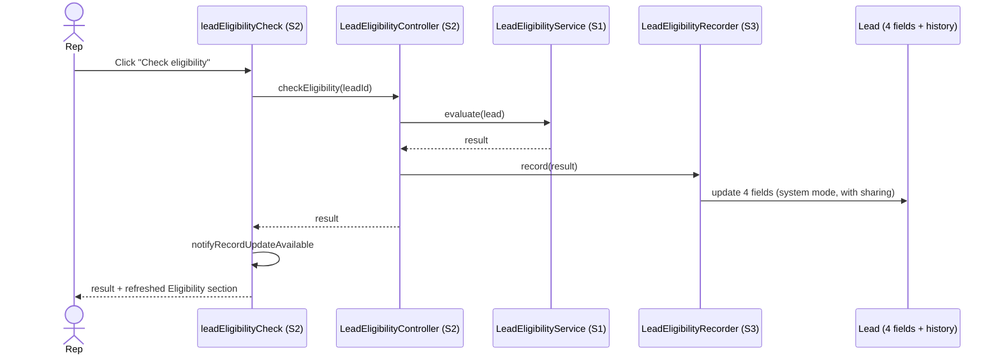

# Architecture: BR014-S3 Recorded eligibility outcome

**Status:** Approved
**Architect:** Asad Kayani — **Decision date:** 2026-10-16

## 1. Context

- **Epic and sibling stories considered:** BR-014 Quick Eligibility Check (SCRUM-5). BR014-S1 Consistent eligibility decision (SCRUM-6, Ready for Release). BR014-S2 Eligibility on demand (SCRUM-7, Ready for Release). BR014-S3 (SCRUM-8, In Progress). All three ship together in release/2026.10.
- **What this story must deliver:** every eligibility check saves its outcome on the lead: the result, the reasons, who checked and when. A new check replaces the saved outcome. Earlier outcomes stay in field history for audit. Managers can report on all four. Reps can see the outcome but can't edit it; only a check sets it. Editing the lead doesn't change the saved outcome.
- **How it fits the siblings:**
  - S1 owns the decision: `LeadEligibilityService.evaluate` returns a `LeadEligibilityResult`. S3 saves that result as is. No rule logic in S3.
  - S2 owns the check: `LeadEligibilityController.checkEligibility` is the one place a check runs. S3 adds one call after `evaluate`.
  - Because the check is the only writer, S3 AC 6 holds by design: nothing recalculates on save.
- **Earlier design:** this brief reuses the decisions of the design approved on 2026-10-13 (`e941639`). The Jira acceptance criteria haven't changed since then. Changes from that design are listed at the end of section 6.

## 2. Current state and impact

Checked against `develop` at `0fa68f0` (S1 and S2 merged, including S2 review fix `53cc489`) and a metadata retrieve from `playbook-dev` on 2026-10-16. The org matches `develop` for every Apex class, the trigger, both LWCs, `Sales_Rep_Base` and the Lead layout (formatting differences only).

| Component                            | Exists today | Impact                                                                                                          |
| ------------------------------------ | ------------ | --------------------------------------------------------------------------------------------------------------- |
| Lead object                          | Yes          | **Changed.** 4 new fields. Turn on field history (`enableHistory` is `false` today; no Lead fields are tracked) |
| LeadEligibilityService / Result (S1) | Yes          | **None.** Read only. S3 saves the result's `outcome` and `reasons`                                              |
| LeadEligibilityController (S2)       | Yes          | **Changed.** After `evaluate`, call the new recorder                                                            |
| leadEligibilityCheck LWC (S2)        | Yes          | **Changed.** After a check, tell the page the record changed so the saved fields refresh                        |
| LeadSelector                         | Yes          | **None.** The recorder doesn't query                                                                            |
| LeadTrigger / LeadTriggerHandler     | Yes          | **No code change.** The save is a Lead update, so the trigger runs. See side effects below                      |
| LeadDataStandardizer                 | Yes          | **No code change.** Runs in before update on the save. See side effects below                                   |
| Lead_Default_Rating flow             | Yes          | **No change.** Before-save flow, runs on the save. See side effects below                                       |
| Sales_Rep_Base                       | Yes          | **Changed.** Read-only access to the 4 new fields                                                               |
| Admin profile                        | Yes (org)    | **Changed.** Read-only access to the 4 new fields, so admins, the Apex test user and CI can see them            |
| Lead-Lead Layout                     | Yes          | **Changed.** New "Eligibility" section with the 4 fields, read only. Add the Lead History related list          |
| Lead_Record_Page                     | Yes          | **None.** Its detail panel shows the layout                                                                     |

Org facts (`playbook-dev`, 2026-10-16):

- Lead sharing is **Public Read/Write/Transfer**, so every rep can edit every lead.
- Lead has no custom fields and no validation rules today. Field history is off; Lead allows up to 20 tracked fields and S3 uses 4.
- The only Lead automation is `LeadTrigger` and the `Lead_Default_Rating` before-save flow. No OmniStudio components, no process builders, no other record-triggered flows.
- The layout's existing `RelatedHistoryList` is **activity** history, not field history. The Lead History related list is new.

Dependencies on sibling stories: S1 and S2 are in `develop`. Nothing blocks the build.

**Side effects of saving on the lead (accepted, low risk):** the save fires the Lead trigger and the before-save flow, like any Lead edit.

- `LeadDataStandardizer` may tidy Company or Country on an older lead that was saved before the standardizer existed.
- `Lead_Default_Rating` may set Rating to Warm on a Web lead with no rating.
- Last Modified By becomes the rep who ran the check.

## 3. Options

The key question is **how a rep's check can write fields the rep can't edit by hand** (AC 5).

|                       | Option A: Read-only fields, saved by Apex in system mode                                                                                                                                                                                 | Option B: Editable fields, guarded by a validation rule                                                                                                                | Option C: Saved asynchronously by a platform event                                                                                                                                     |
| --------------------- | ---------------------------------------------------------------------------------------------------------------------------------------------------------------------------------------------------------------------------------------- | ---------------------------------------------------------------------------------------------------------------------------------------------------------------------- | -------------------------------------------------------------------------------------------------------------------------------------------------------------------------------------- |
| Summary               | Reps get read-only access to the 4 fields. A new `with sharing` recorder class saves them with `AccessLevel.SYSTEM_MODE`, which skips field permissions but still applies record sharing.                                                | Reps get edit access. A validation rule blocks changes unless a hidden "set by check" flag is set, which the Apex sets.                                                | The controller publishes an event; a trigger running as the Automated Process user saves the fields.                                                                                   |
| Pros                  | Reps truly can't edit the fields anywhere: page, list view, API, data loader (AC 5). Saved in the same transaction as the check, so the result shown always matches the result saved. Sharing still applies. Simple: one class, one DML. | Keeps user-mode DML, the team default.                                                                                                                                 | Clean separation; no field-permission bypass in the rep's transaction.                                                                                                                 |
| Cons                  | **Deliberately bypasses field-level security for these 4 fields.** Goes against the `CLAUDE.md` rule "DML uses `AccessLevel.USER_MODE`". Code Analyzer did not flag this pattern in the 2026-10-13 probe, so review is the only control. | Anyone with edit access and API skills can set the flag and the fields together, so AC 5 is weak. Hidden flag field is a workaround that confuses reports and history. | More parts (event, trigger, subscriber). Saved later than shown, so a reload right after a check can show the old outcome. "Who checked" must be carried in the event. Harder to test. |
| Fits sibling stories? | **Yes.** One call added to S2's controller; S1 unchanged.                                                                                                                                                                                | Partly. Same S2 change, plus a validation rule and flag field.                                                                                                         | Partly. S2 publishes an event instead of saving.                                                                                                                                       |

Also considered and rejected: a child "Eligibility Check" object holding every check. It gives a full audit trail but goes against AC 2 ("replaces the saved outcome on the lead") and AC 3 ("through the lead's field history"), and makes AC 4 reports harder.

## 4. Security and NFRs

- [x] **Sharing model and class sharing keywords:** `LeadEligibilityRecorder` is `with sharing`. With `AccessLevel.SYSTEM_MODE`, Salesforce skips object and field permissions but still applies sharing from the class keyword, so a rep can only save the outcome on a lead they can edit. Today every rep can edit every lead (Public Read/Write/Transfer).
- [x] **CRUD/FLS:** the query stays `WITH USER_MODE` (S2, unchanged). The save is the one **deliberate exception**: system mode, limited to `Id` + the 4 eligibility fields. The recorder builds new `Lead` records with only those 5 fields, so no other field can be written through it. It also checks the rep has Lead edit access (`Schema.SObjectType.Lead.isUpdateable()`) before saving. **Needs architect approval** as a deviation from the `CLAUDE.md` DML rule (open question 1).
- [x] **Admin read access:** new fields deployed by metadata get no field access on any profile. The `Admin` profile gets read only on the 4 fields (field permissions only), so admins, the Apex test user and CI can see them. Nobody gets edit.
- [x] **No hand edits (AC 5):** `Sales_Rep_Base` grants read, not edit, on the 4 fields; the layout marks them read only. The result and reasons fields are restricted picklists, so only known values can be saved.
- [x] **Bulk:** `record(List<LeadEligibilityResult>)` builds the updates in memory and saves them with one DML. Test with 200 results.
- [x] **Governor limits:** a check is now 1 SOQL + 1 DML (plus trigger and flow, both bulk-safe). Well within limits and S2's 2-second target.
- [x] **Data classification:** the fields hold rule results and a user lookup, no new personal data. Field history keeps the same values. No `System.debug` of lead data.
- [x] **Audit:** field history keeps each change with old value, new value, who and when (AC 3). Salesforce keeps Lead field history for 18 months by default.

## 5. Recommendation

**Option A: read-only fields, saved by Apex in system mode.**

It is the only option where reps really can't change the outcome by hand (AC 5) and the saved outcome always matches the one shown. It adds one class and one call to S2's controller. The trade-off is a deliberate, narrow field-level security bypass: four fields, one class, sharing still enforced. Code Analyzer won't catch misuse of this pattern, so the architect's approval and the code review are the controls.

## 6. Design and build plan

| #   | Component                                                     | Type                                                                                | New/Changed | Test           |
| --- | ------------------------------------------------------------- | ----------------------------------------------------------------------------------- | ----------- | -------------- |
| 1   | `Lead.Eligibility_Result__c`                                  | Picklist (restricted): Eligible, Not eligible. History tracked                      | New         | #6             |
| 2   | `Lead.Eligibility_Reasons__c`                                 | Multi-select picklist (restricted): the 9 reason texts from S1. History tracked     | New         | #6             |
| 3   | `Lead.Eligibility_Checked_By__c`                              | Lookup(User), clear the value if the user is deleted. History tracked               | New         | #6             |
| 4   | `Lead.Eligibility_Checked_On__c`                              | Date/Time. History tracked                                                          | New         | #6             |
| 5   | `Lead` object                                                 | Object settings: `enableHistory` true                                               | Changed     | #6             |
| 6   | `LeadEligibilityRecorder` + `LeadEligibilityRecorderTest`     | Apex class + test                                                                   | New         | —              |
| 7   | `LeadEligibilityController` + `LeadEligibilityControllerTest` | Apex class + test (S2)                                                              | Changed     | #7             |
| 8   | `leadEligibilityCheck` + Jest test                            | LWC (S2)                                                                            | Changed     | #8             |
| 9   | `Sales_Rep_Base`                                              | Permission set: read only on fields 1–4                                             | Changed     | #6 (AC 5 test) |
| 10  | `Admin` profile                                               | Profile: read only on fields 1–4 (field permissions only)                           | Changed     | #6, #12        |
| 11  | `Lead-Lead Layout`                                            | Layout: "Eligibility" section (fields 1–4, read only) and Lead History related list | Changed     | #12            |
| 12  | `tests/ui/story/BR014-S3.spec.ts`                             | Playwright story test                                                               | New         | —              |

**Reason values (field 2):** exactly the reason texts S1 produces today (`LeadEligibilityService`): "Not based in the US, Canada or UK", "Fewer than 50 employees", "Annual revenue is below 1M", "Industry is Government or Education", "Country is missing", "Number of employees is missing", "Annual revenue is missing", "Industry is missing", "Email is missing". A test fails if S1 can produce a reason that isn't a picklist value.

**`LeadEligibilityRecorder`** (`with sharing`):

- `public static void record(List<LeadEligibilityResult> results)`: for each result, a new `Lead(Id = result.leadId)` with the 4 fields set: result = `outcome`, reasons = `String.join(reasons, ';')` (blank when eligible), checked by = `UserInfo.getUserId()`, checked on = `System.now()`. One `Database.update(leads, AccessLevel.SYSTEM_MODE)`.
- Checks `Schema.SObjectType.Lead.isUpdateable()` first and throws `NoAccessException` if the rep can't edit leads.
- No rule logic, no queries.

**`LeadEligibilityController` (S2), changed:** after `evaluate`, call `LeadEligibilityRecorder.record(new List<LeadEligibilityResult>{ result })`. If the save fails (`DmlException`, `NoAccessException`), throw a handled exception through the existing `handled()` helper: "The check ran but the result couldn't be saved. Refresh the page and try again." (open question 3). Return the result as before.

**`leadEligibilityCheck` (S2), changed:** after a successful check, call `notifyRecordUpdateAvailable([{ recordId }])` so the page's Eligibility section shows the new saved outcome without a reload.

**Tests:**

| Test                                                                                                                                               | Type       | Covers                          |
| -------------------------------------------------------------------------------------------------------------------------------------------------- | ---------- | ------------------------------- |
| A check saves result, reasons, checked by (the running user) and checked on (now)                                                                  | Apex       | AC 1                            |
| An eligible lead saves "Eligible" and no reasons                                                                                                   | Apex       | AC 1                            |
| A second check replaces all 4 values with the latest                                                                                               | Apex       | AC 2                            |
| All 4 fields have field history tracking on (`FieldDefinition.IsFieldHistoryTracked`)                                                              | Apex       | AC 3                            |
| All 4 fields are filterable; result, checked by and checked on are groupable (describe)                                                            | Apex       | AC 4                            |
| A rep with `Sales_Rep_Base` can read the 4 fields but not edit them (describe as the rep); a user-mode update of the result field as the rep fails | Apex       | AC 5                            |
| The same rep can run a check and the outcome is saved                                                                                              | Apex       | AC 5                            |
| Changing employees after a check leaves the saved outcome unchanged                                                                                | Apex       | AC 6                            |
| Every reason S1 can produce is a valid reasons value                                                                                               | Apex       | AC 1 (guards S1/S3 drift)       |
| Recording 200 results saves all 200 with one DML                                                                                                   | Apex       | Bulk                            |
| Controller: a check saves the outcome; a failed save gives the clear message                                                                       | Apex       | AC 1, S2 AC 7                   |
| LWC calls `notifyRecordUpdateAvailable` with the lead Id after a check, and not after a failed check                                               | Jest       | AC 5 (page shows saved outcome) |
| Run a check on Pine County Services: the Eligibility section shows Not eligible, both reasons, checked by and checked on                           | Playwright | AC 1, 5                         |
| Run a check, change the lead, reload: saved outcome unchanged; check again: it updates; Lead History lists both outcomes                           | Playwright | AC 2, 3, 6                      |

Field history entries are not created in Apex tests, so AC 3's history list is verified in Playwright or by QA (open question 5). Report building (AC 4) is verified by QA in the org.

**Deploy order:** fields 1–4 with Lead history on → `Sales_Rep_Base` and `Admin` profile → `LeadEligibilityRecorder` + test → `LeadEligibilityController` + test → `leadEligibilityCheck` → `Lead-Lead Layout`.

**Tests:** Apex: `LeadEligibilityRecorderTest`, `LeadEligibilityControllerTest` (step 16). Jest: `leadEligibilityCheck` (step 14). Playwright: `tests/ui/story/BR014-S3.spec.ts` (step 17).

**Changes from the 2026-10-13 design (`e941639`):**

- The S2 review fix `53cc489` is now in `develop`, so the build blocker and old question 6 are gone.
- The `Admin` profile row (added during the last build) is in the plan from the start (row 10).
- The Playwright test follows S2's naming: `tests/ui/story/BR014-S3.spec.ts` instead of `lead-eligibility-outcome.spec.ts`.
- The Jest test also checks that a failed check doesn't refresh the page.

## 7. Open questions for the business

1. **Field-level security exception.** To meet AC 5, the check saves the 4 eligibility fields in system mode, even though reps can only read them. Sharing still applies; nothing else on the lead can be written this way. This goes against the team rule "DML uses user mode", and Code Analyzer won't flag it. Do you approve this exception for `LeadEligibilityRecorder` only?
   - **Answer:** Approved, for `LeadEligibilityRecorder` and the 4 eligibility fields only. Code review must check it, since Code Analyzer won't.
2. **Reports by reason.** Reasons are a multi-select picklist, so managers can **filter** leads by reason ("Reasons includes Email is missing") but can't **group** a report by reason. Result, checked by and checked date can be grouped. Is filtering by reason enough for AC 4?
   - **Answer:** Yes. Filtering by reason is enough; result, checked by and checked date can be grouped.
3. **When the save fails.** If the outcome can't be saved (for example, the lead was just locked or deleted), should the rep still see the result, or only an error? This design shows only the error message, so a result is never shown without being saved.
   - **Answer:** Show only the error. A result is never shown without being saved.
4. **Who are "managers"?** The design gives read access to the 4 fields through `Sales_Rep_Base`. Should sales managers get a separate permission set, or is `Sales_Rep_Base` fine for the demo?
   - **Answer:** `Sales_Rep_Base` is fine. No separate manager permission set.
5. **Audit check.** Salesforce doesn't create field history in Apex tests. Is a Playwright or QA check of the Lead History related list enough evidence for AC 3?
   - **Answer:** Yes. Apex proves tracking is on for all 4 fields; Playwright or QA shows real history entries.

## 8. Approval

- **Decision:** Approved: Option A (read-only fields saved by `LeadEligibilityRecorder` in system mode)
- **Architect:** Asad Kayani, 2026-10-16
- **Open questions:** all answered in section 7
- **Plan changes:** none
- **Conditions:** none
- **Blockers before build:** none. S1 and S2 components (`LeadEligibilityService`, `LeadEligibilityResult`, `LeadEligibilityController`, `leadEligibilityCheck`) are in `develop`.
